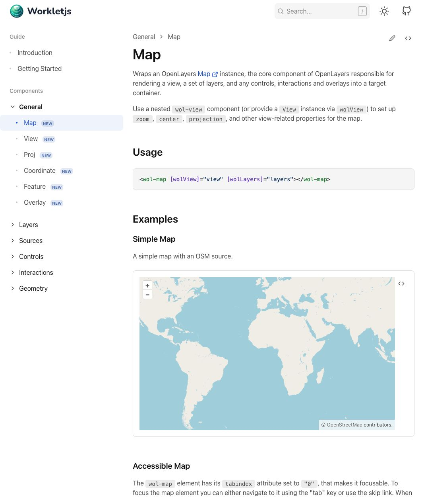

# Nx / Angular 升级验收记录

日期：2026-10-13。集成分支：`codex/nx-angular-upgrade`。

## 环境与解析结果

- Node `24.21.0`，pnpm `10.34.5`。
- Nx 与全部直接 `@nx/*` 为 `23.3.0`；Angular Framework、CLI、DevKit、CDK、Material 解析为 `22.2.2`。
- ng-packagr `22.2.4`，Analog 两个包 `2.8.0`，NgDoc 五个直接依赖均为 `22.0.0-beta.2`。
- 保留 TypeScript `6.0.3`、直接 Vite 7、Vitest `4.0.9`；三个 workspace 包版本均为 `22.0.1`。
- 四项增量迁移从明确的 Nx `23.1.0` 基线生成并执行，详见[工单 01](issues/01-toolchain-upgrade.md)。

## 自动检查

| 检查                                           | 结果                                                                           |
| ---------------------------------------------- | ------------------------------------------------------------------------------ |
| 冻结离线安装，复用现有 pnpm store              | 通过；1781 个包，零下载，锁文件未改变                                          |
| `pnpm test`                                    | 通过；17 项脚本、92 个库测试文件 / 2306 项断言、8 个 docs 测试文件 / 35 项断言 |
| `node --test scripts/deploy-workflow.spec.mjs` | 7 项部署工作流回归通过                                                         |
| `pnpm lint`                                    | 库和 docs 均通过                                                               |
| `pnpm format:check`                            | 通过                                                                           |
| `pnpm build`                                   | 库 production 构建通过                                                         |
| docs production 构建                           | 通过，等价于 `pnpm build:docs` 的默认目标                                      |
| `pnpm build:docs-preview`                      | 通过；产物 base href 为 `/preview/`                                            |
| pnpm 10.34.5 打包及真实 tarball 检查           | 通过；Angular Core/CDK peer 均为 `~22.2.0`，版本为 `22.0.1`                    |
| 全部 secondary entry point 与导出目标文件      | 92 个入口均存在，导出引用的文件全部在 tarball 中                               |
| Commitlint 与 `git diff --check`               | 通过                                                                           |

本地 Nx 检查设置 `NX_DAEMON=false`、`NX_ISOLATE_PLUGINS=false`，避免沙箱 Unix
socket 限制。文档生成需读取 Angular 官方 API 索引；初次沙箱构建受网络限制，之后在允许网络的环境使用现有代理重试并通过。未为此修改 NgDoc 版本或文档 builder。

库构建 manifest 保留 catalog 引用，pnpm
10.34.5 在打包时展开版本；验收检查的是实际发布 tarball。系统默认 pnpm 与工作区指定版本可能不同，打包时已明确使用 pnpm
10.34.5。

## 浏览器冒烟检查

对 preview production 产物使用仅监听 `127.0.0.1` 的临时静态服务，完成以下检查：

- 首页加载、导航到 Getting Started，新旧 Angular 兼容说明及代码块显示正常。
- 导航到 Map 组件页面，NgDoc 生成的组件 API、示例及静态资源正常显示。
- Simple Map 的 OSM 瓦片正常显示；点击放大、缩小按钮，地图按预期重新渲染。
- 刷新 `/preview/components/general/map` 深层路由后，页面和地图正常恢复。
- 浏览器捕获的 JavaScript error 日志为空。

首页的 MapTiler 服务在本地验收时返回 `Invalid key`
瓦片，其 URL 和 key 在本次改动中未变化。该外部服务授权配置不在本次升级范围内；OSM 示例的渲染和交互已实际验证。

验收结束后已关闭临时浏览器标签页和 HTTP 服务。

## Standards

初次审查发现一项 P3：已 resolved 的工单 01、02、03 未在实施图的 `Decisions-so-far`
中记录完成摘要及链接，不符合本地 issue tracker 的关闭约定。

单一修复 implementer 在 `0eeda67`
补齐记录，已通过 rebase 纳入线性集成历史。Standards 审查者复核确认该问题已解决，其余书面规范及 Fowler
smell 均零发现。

## Spec

零发现。版本目标、保留 NgDoc beta、catalog、Node
24、库版本、增量迁移、Zone 初始化、当前源码与历史发布兼容说明均符合已确认需求。

Google 测试网络隔离和 docs 专属 generated
alias 例外均为真实升级失败所需的兼容修复，未改变库公开行为。

审查汇总：Standards 初次 1 项（P3，已修复），当前 0 项未解决；Spec 0 项。

## 提交与收尾

| 提交      | 内容                                          |
| --------- | --------------------------------------------- |
| `1ff56ff` | 需求文档、实施图和工单依赖图                  |
| `6b5c8ba` | Node 24 及 CI / 发布环境约束                  |
| `10b254e` | Angular 22.2 源码与历史发布兼容说明           |
| `0fd0259` | Nx / Angular / 配套工具升级、锁文件及增量迁移 |
| `802a33d` | Google 测试公开网络边界隔离及错误响应断言     |
| `8894866` | docs 作用域的 NgDoc generated alias lint 修复 |
| `0eeda67` | 审查发现的实施图记录修复                      |

各实施提交均已合入集成分支。四个实施子 worktree 与其临时分支已清理，保留项目 `.worktrees/`
下的集成 worktree。未执行包发布或站点部署。

## Rebase 历史整理

- 2026-10-13：按用户要求将四个 merge commit 展平，保留九个独立实施及记录提交。
- 整理前的完整历史保留在 `codex/nx-angular-upgrade-before-rebase`。
- rebase 完成时与备份分支的 Git
  tree 完全一致；随后仅同步本文及工单 01 的提交编号和整合说明，生产代码与截图均未变化。
- 原四个 merge 的 combined diff 和 remerge diff 均为空，没有仅存在于 merge 中的改动或冲突解决。
