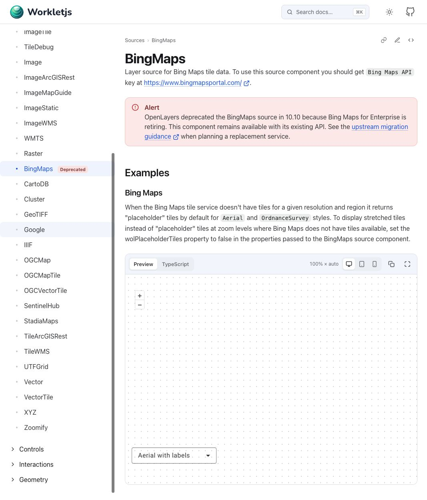
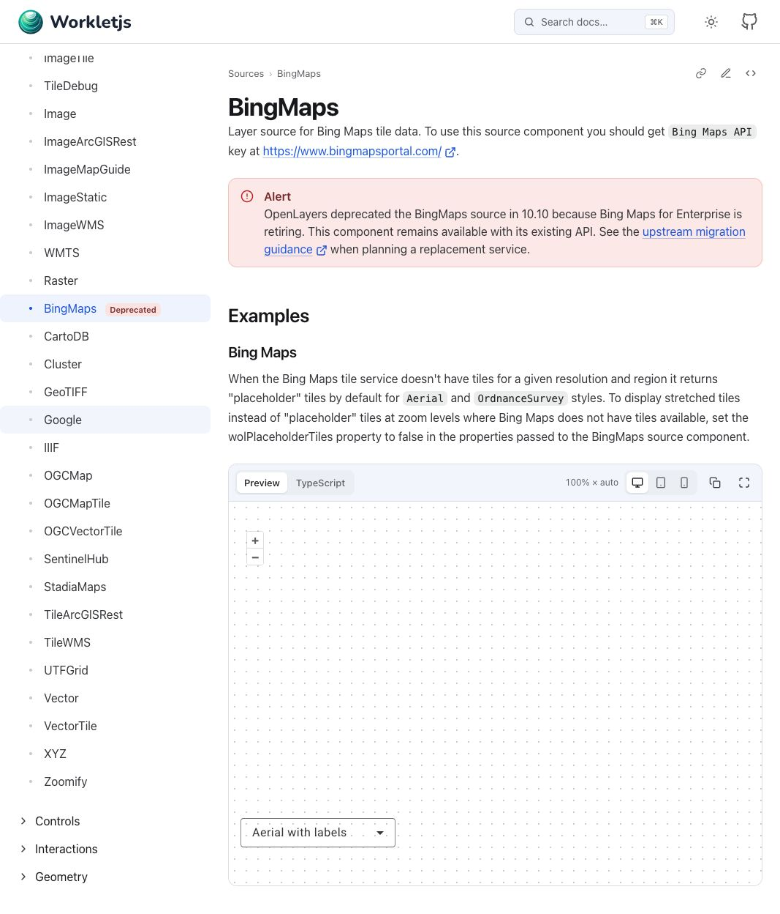

# OpenLayers 10.11 升级验收记录

验收日期：2026-10-14（Asia/Shanghai）。需求：[spec.md](spec.md)。

验收对象为集成提交 `0f6f5cb`，在独立分支 `codex/openlayers-validation` 和项目内
`.worktrees/openlayers-validation` 工作区中完成。使用 Node `24.21.0`、项目指定的 pnpm
`10.34.5`，安装后的 OpenLayers 为 `10.11.0`。本记录只涉及本地检查与产物，不执行发布或部署。

## 工作区检查

安装先在受限网络中遇到 `EPERM`，停止后以获准的网络访问重新执行冻结安装；成功命令没有更新锁文件。

```sh
pnpm install --frozen-lockfile

export NX_DAEMON=false
export NX_ISOLATE_PLUGINS=false
export NX_SKIP_NX_CACHE=true

pnpm test
pnpm lint
pnpm format:check
pnpm build
pnpm build:docs
pnpm build:docs-preview
```

| 检查              | 结果                                    |
| ----------------- | --------------------------------------- |
| 冻结安装          | 通过，pnpm 10.34.5，7.8 秒              |
| 脚本测试          | 30 项通过，0 失败、取消或跳过           |
| 组件库测试        | 92 个文件、2311 项测试通过              |
| 文档应用测试      | 8 个文件、36 项测试通过                 |
| 组件库与文档 lint | 均成功，退出码 0；组件库有下述 2 项警告 |
| 格式检查          | 通过，退出码 0                          |
| 组件库构建        | 成功，Nx 1 task / 1 succeeded           |
| 正式文档构建      | 成功，Nx 1 task / 1 succeeded，36.2 秒  |
| preview 文档构建  | 成功，Nx 1 task / 1 succeeded，8.8 秒   |

所有 Nx 测试、lint 和构建均实际执行，输出记录
`Cache: Skipped (--skip-nx-cache)`。测试统计来自本次运行的 Nx
terminalOutputs，合计 2377 项，未从历史结果推算。

非阻断提示：VectorTile source 测试的两处非空断言产生 `@typescript-eslint/no-non-null-assertion`
警告；与固定基线比较确认该文件未改，断言已存在。文档构建提示部分压缩 chunk 超过 500
kB，并输出插件耗时诊断。组件库测试输出包含 jsdom 外部请求的 `ENOTFOUND api.example.com`
等诊断，所有断言仍通过；这些诊断不作为真实浏览器渲染的证据。

额外尝试的独立测试类型检查（非既有测试入口）未通过：对照 10.9 安装有 21 项既有诊断，10.11 可空声明又暴露现有测试的 29 项诊断。新增 Raster 回归没有引入类型诊断；本次未扩大为既有测试的整体类型清理，详情见[工单 01](issues/01-dependencies-and-raster.md)。正式库构建和既有测试入口的结果如上表。

原始命令日志保存在 `/private/tmp/openlayers-upgrade-*.log`；其中
`test-library-output.log`、`test-docs-output.log`、`build-library-output.log` 和
`build-docs-preview-output.log` 保留了 Nx 隐藏在简要输出后的实际任务输出。

## 真实发布产物

在组件库构建输出目录执行项目版本的 pnpm
`pack --pack-destination /private/tmp/openlayers-upgrade-pack`，只生成 tarball，不发布。此目录没有自身的
`packageManager`
声明，直接调用全局 pnpm 会选择 12.10.1 并无法展开 catalog；实际验收明确调用 pnpm 缓存中的 10.34.5 可执行文件后成功。

检查真实的 `workletjs-ngx-openlayers-22.0.1.tgz`，而非只读取源码清单或构建目录：

- 包版本保持 `22.0.1`。
- `peerDependencies.ol` 为 `~10.11.0`，Angular core/cdk peer 均为 `~22.2.0`。
- 包清单不含 `catalog:` 引用。
- 源码的全部 92 个 secondary entry point 都出现在 tarball 根清单的 exports 中。
- 共 94 项 exports（包含主入口与 package.json）、281 个归档文件；递归检查每个导出目标均存在。
- ng-packagr 有意在 `.npmignore`
  中排除仅供开发使用的嵌套 package.json；这些文件不作为发布入口完整性的判断标准。

校验通过的结构化记录保存在 `/private/tmp/openlayers-upgrade-tarball-validation.json`。

## 正式与 preview 文档元数据

每次文档构建成功后，立即将浏览器产物与当次生成的 context 分别保存：

| 产物    | 快照目录                                     | HTML base   |
| ------- | -------------------------------------------- | ----------- |
| 正式    | `/private/tmp/openlayers-upgrade-production` | `/`         |
| preview | `/private/tmp/openlayers-upgrade-preview`    | `/preview/` |

两份 context 分别保存在 `/private/tmp/openlayers-upgrade-production-context.ts` 与
`/private/tmp/openlayers-upgrade-preview-context.ts`，未使用后一次构建覆盖前一次的校验证据。

从真实生成的 context 读取 navigation 并扁平化，移除 `NEW` 状态后，与升级前的
`/private/tmp/openlayers-upgrade-baseline-navigation.json` 逐项深度比较：

| 构建    | 导航实体 | 页面 | 分类 | NEW | EXPERIMENTAL | 其余导航内容与基线 |
| ------- | -------- | ---- | ---- | --- | ------------ | ------------------ |
| 正式    | 95       | 87   | 8    | 0   | 3            | 完全一致           |
| preview | 95       | 87   | 8    | 0   | 3            | 完全一致           |

比较包括原有标题、路由、顺序、展开和隐藏设置以及其他元数据。两份扁平化结果与断言摘要保存在
`/private/tmp/openlayers-upgrade-{production,preview}-navigation.json` 和
`/private/tmp/openlayers-upgrade-navigation-validation.json`。

## 浏览器验收

通过真实浏览器访问上述正式与 preview 静态快照，检查可见图像、交互、导航状态和控制台。

| 场景                    | 实测结果                                                                                                     | 截图                                                                                        |
| ----------------------- | ------------------------------------------------------------------------------------------------------------ | ------------------------------------------------------------------------------------------- |
| 正式 Map / OSM          | 地图瓦片真实显示，`+` 与 `−` 缩放后图像改变                                                                  | [初始](screenshots/map-production.jpg)、[缩小后](screenshots/map-production-zoomed-out.jpg) |
| 正式 VectorImage        | 世界生态区矢量图真实显示，组件导航无 NEW，3 个 EXPERIMENTAL 保留                                             | [VectorImage](screenshots/vector-image-production.jpg)                                      |
| 向量图层旋转            | 临时 π/4 输入真实渲染为 45°；点击 reset control 后为 0 rad，canvas 变换恢复 identity                         | [旋转](screenshots/vector-image-rotated.jpg)                                                |
| 正式 VectorTile         | ArcGIS 蓝色矢量边界真实显示，点击要素显示属性 `{"_symbol":0,"layer":"Watershed boundary"}`                   | [VectorTile](screenshots/vector-tile-production.jpg)                                        |
| 正式 GeoTIFF / WebGL    | Reprojection 卫星影像真实显示；CloudOptimized 与 Blob 各存在非零尺寸 canvas，3 项通过；另 2 项受限，详见下文 | [GeoTIFF](screenshots/geotiff-production.jpg)                                               |
| preview Map 深链        | 直接打开并 reload 成功，2 个 canvas，base `/preview/`；导航 0 NEW、3 EXPERIMENTAL                            | [preview Map](screenshots/map-preview.jpg)                                                  |
| preview Getting Started | 页面显示 `~10.11.0` 安装要求及 `Intl.Segmenter` 迁移提示                                                     | 页面内容实测                                                                                |

Map、VectorImage 和 VectorTile 在进入 GeoTIFF 页面前控制台错误为 0；GeoTIFF 页面产生下述 2 条请求错误，之后旋转与 preview 检查没有新增错误。

向量图层旋转检查使用现有 VectorImage 示例和公开的 `wolRotation` 输入，临时设置为
`0.7853981633974483`（π/4），清空当前工作区的 NgDoc 生成与缓存目录后执行
`DOCS_BASE_HREF=/rotation/ pnpm build:docs`，其余 Nx 环境变量与上文相同。此实际构建成功（30.1 秒、缓存跳过），另存到
`/private/tmp/openlayers-upgrade-rotation`，HTML base 为
`/rotation/`。生成的示例资源包含旋转绑定；构建后立即恢复源文件，确认源码 diff 为空。此临时验收 fixture 不进入提交，正式与 preview 快照没有被修改。

GeoTIFF 页面中的 WithOverviews 与 COGMathMultiSource 没有生成 canvas，控制台记录两条
`AggregateError: Request failed`。对两项原有示例 URL 执行获准联网的 HEAD 和 `Range: bytes=0-1023`
GET，请求带实际浏览器 Origin：

- `openlayers.org/data/raster/no-overviews.tif` 及其 `.ovr` 均返回 Cloudflare HTTP 403。
- EOX 的 `R10m.tif` 和 `R60m.tif` 均重定向至
  `https://cloudlessdownloads.eox.at/share/jvu06wnt`，最终虽为 HTTP 200，内容类型却是
  `text/html; charset=utf-8`，而非 GeoTIFF；响应也没有允许跨域访问的 `Access-Control-Allow-Origin`。
- 两项示例源文件与固定基线没有差异，未修改数据 URL 或授权配置。上述远端响应独立于 OpenLayers 版本，足以使当前示例请求失败；这两项检查记录为外部数据服务受限，未通过，不据此声称它们的渲染已得到验证。

原始浏览器错误与远端请求证据分别保存在
[geotiff-console-errors.json](screenshots/geotiff-console-errors.json) 和
[geotiff-remote-checks.json](screenshots/geotiff-remote-checks.json)。

## Standards

独立审查固定范围 `b96207d...5488711`，按 AGENTS、issue-tracker、domain 规范和 Fowler smell
baseline 核对：**0 findings**。

行为变更具备 colocated 回归，覆盖真实采样、动态增删、嵌套销毁、宿主解绑和实例身份。提交符合 Conventional
Commits，依赖、行为修复、测试适配和文档分别记录。工单状态与审查时的实施阶段一致，未提前宣称审查或清理完成；未发现可行动的规范违反或新增 smell。

## Spec

独立审查同一固定范围，对照本次规格、工单和验收证据：**0 findings**。

依赖范围、必要传递依赖、Raster 原实例采样同步、NEW 清理与 EXPERIMENTAL 保留，以及真实 tarball 和导航结果均符合需求。未发现需求遗漏、范围扩展或错误实现；两项 GeoTIFF 受限场景有 HTTP 证据且明确未计为通过。审查后的改动仅补齐工单关闭与本记录，不改变已验收代码。

## 提交记录与收尾

| 提交                            | 内容                                        |
| ------------------------------- | ------------------------------------------- |
| `800eb6e`                       | 需求设计、实施图与工单依赖图                |
| `690e678`                       | OpenLayers 10.11.0 与必要传递依赖           |
| `6c98d72`                       | 当前源码兼容要求与迁移说明                  |
| `4441165`                       | 移除 82 个 NEW 声明，保留 3 个 EXPERIMENTAL |
| `d18f771`                       | Raster 动态采样修复、5 项回归及生命周期验证 |
| `cd9aff5`                       | Feature 与 Flow 的上游行为测试适配          |
| `1dbb75b`、`52bd57a`、`0f6f5cb` | 工单交付与集成状态记录                      |
| `e9912e1`                       | 实现分支同步集成分支                        |
| `c83b3f5`                       | 完整验收、截图和外部数据服务证据            |
| `5488711`                       | 验收交付整合                                |

集成分支为
`codex/openlayers-upgrade`，保留全部聚焦提交及一次必要的分支同步 merge。三个实现者 worktree 均在项目
`.worktrees/`
下创建，全部交付合入后已移除，三个临时实现分支也已安全删除；当前项目保留集成分支。临时浏览器及本机静态服务已关闭，未发布包或部署站点。

审查汇总：Standards 0 项；Spec 0 项。

## BingMaps 弃用展示补充验收

2026-10-14，按 [PR #52](https://github.com/workletjs/workletjs/pull/52) 创建后的补充需求完成
[04 工单](issues/04-bingmaps-deprecation.md)。BingMaps 页面使用 `@status:alert Deprecated`
标签，现有弃用段落按 [NgDoc 官方用法](https://ng-doc.com/docs/write-content/markdown-and-callouts/)
改为 Alert Callout，保留弃用原因、现有 API 可用说明和上游迁移链接。

- `NX_DAEMON=false NX_ISOLATE_PLUGINS=false NX_SKIP_NX_CACHE=true pnpm test:docs` 通过。
- 相同环境下 `pnpm nx lint docs --output-style=static` 通过。
- 相同环境下 `pnpm build:docs`、`pnpm build:docs-preview` 通过，分别实际生成 `/` 和 `/preview/`。
- 相关 Markdown、页面配置的 Prettier 检查及 `git diff --check` 通过。
- 生成导航保持 0 个 NEW、3 个 EXPERIMENTAL，仅 BingMaps 新增 1 个 Deprecated。生成正文含原生
  `type="alert"` Callout。
- 两种构建均通过本地实际页面检查：侧栏显示红色 Deprecated 标签，正文显示红色 Alert、完整说明及迁移链接。
- 只读独立审阅无发现；没有组件运行时行为变更，未新增镜像实现的测试。

浏览器首次使用错误路径 `/source/bing-maps`，后改为生成路由中的
`/components/sources/bing-maps`；期间有一次动态 chunk 加载失败。构建完成后重新访问正确路径，正式与 preview 均成功显示，没有据此更改组件或文档配置。示例沿用原 API
key，本次仅验收标签与 Callout，不将 Bing Maps 底图加载列为通过项。




